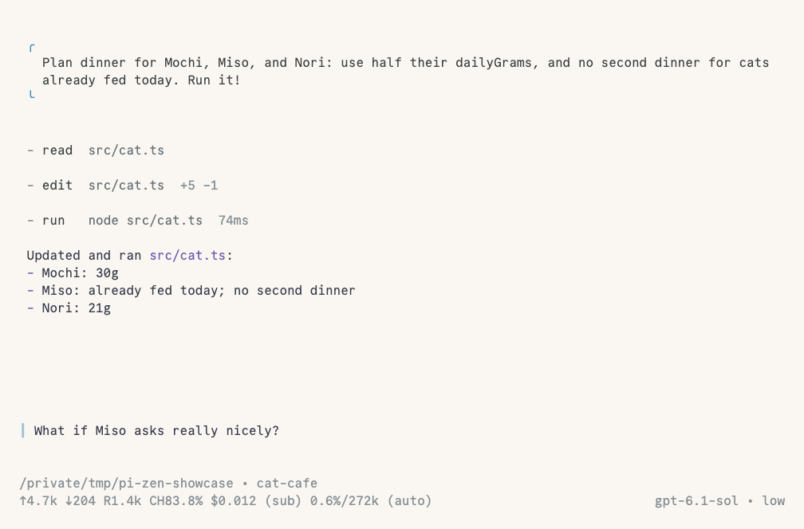
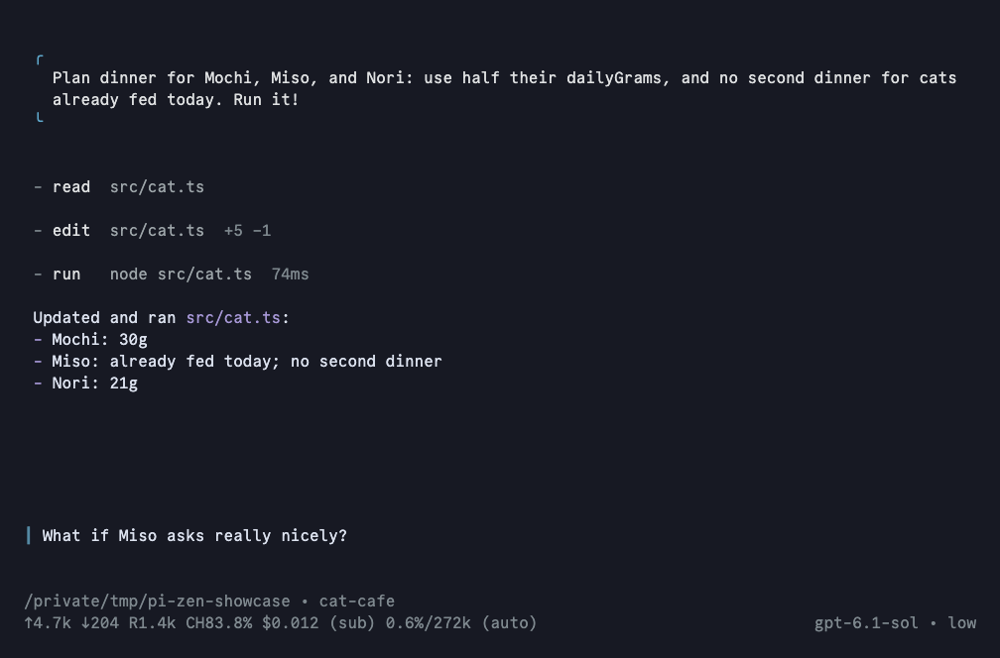
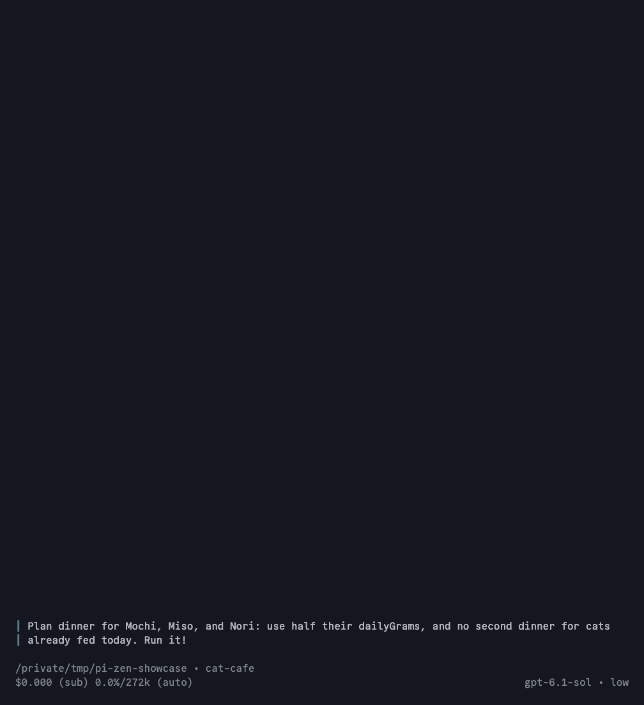

# pi-zen

I built `pi-zen` because I wanted a minimal interface that made it easier to stay present in an agent session. I did not want to keep scrolling through long stretches of context to find the few details I needed; I wanted a clean way to follow along, ask questions, and steer and ride the loop.

For real knowledge work, I like being an active participant. I want to understand what is happening between the AI and me so we can be good partners in making decisions. `pi-zen` gives me that space: clear responses, visible progress, and the useful parts of the session in a calm, visually appealing interface.

`pi-zen` is a presentation extension for the [Pi](https://pi.dev) terminal interface. It removes visual clutter while preserving conversations, tool activity, reasoning, and session data. The terminal stays an open canvas: a bold left bar marks sent text, without corners or a background fill, while replies and reasoning stay on the page without names or filled panels. It also adds compact tool summaries and diffs, a minimal editor rail, a quieter startup, a quiet loading mark that names the work in progress, and a live reading of where the current request's time is going, without changing tool execution or model prompts.

## Showcase

A tiny TypeScript dinner planner for Mochi, Miso, and Nori: personalized portions, and no second dinner for Miso, our resident snack thief. Captured from live Pi sessions in Rex, running the local extension. The screenshots keep tool rows compact; the GIF opens them to show the code.

### Light mode



### Dark mode



### Cat café coding demo

Read the planner, edit the feeding rules, and run it. The GIF shows compact tool rows and the live activity line, then `Ctrl+O` reveals the source, syntax-highlighted diff, and dinner menu.



## While a request runs

While a request is in progress, a light travels a short bar above the editor and comes back. Beside it, a quiet line names the current activity: `thinking`, `writing`, `reading`, `searching`, or `running a command`. Several reads at once share one label, such as `reading (3)`. A codemode script can supply its own purpose through its introductory comment. Intent, findings, and decisions stay in the model's own conversation; Zen never invents them from tool activity.

Reasoning stays visible by default in Zen mode, using Pi's native rendering, without a separate reveal prompt. Pi's thinking toggle and per-block clicks still work; an explicit visibility choice carries forward to new messages. `/zen details` remains an alias for `/zen on`; repeating either command preserves native visibility choices. `/zen off` restores Pi's configured thinking visibility. Consecutive tools share one expandable activity block, even across reasoning turns. Assistant text and user messages start a new group. The summary names the actual tools and keeps failures and currently running tools visible. Failed rows stay visible under the collapsed group, including nested failures while a codemode script is still running. Direct MCP calls join the same group and use `server/tool` names; expanding a row reveals its arguments and output.

Tool rows keep subjects readable while their markers and timings recede. Long commands and multiline shell scripts keep a compact label, and a successful command with one short output line keeps that answer beside its duration. Empty results such as `{}` add no summary text. Failed commands surface a reported diagnostic before falling back to the first output line.

A dim line above the editor says where the time is going and updates as the request runs:

```text
7.2s thinking · 3.6s writing · ↑6.5k ↓5.8k
```

Thinking is the time the model spends reasoning, including the silence before it streams anything; writing is the time it spends producing text and tool calls. Time a tool spends running belongs to neither and is left out. The token counts follow Pi's footer: tokens sent, excluding cache reads and writes, and tokens produced, reasoning included. Both cover the whole request, however many turns it takes. A half of the work that took no measurable time is left out, so a model that does not stream its reasoning simply reads as writing. The final reading stays until the next request starts.

Replies use Pi's native Markdown renderer, including syntax highlighting for every language its highlighter supports. Unknown or missing language tags stay plain. Zen hides the displayed code fences, leaving indented, highlighted code with breathing room around it. The Markdown itself stays intact, including blank lines, nested blocks, and incomplete fences during streaming. Colors and wrapping follow the active Pi theme and terminal width. Reasoning uses the same Markdown renderer. `/zen off` restores Pi's fences and configured reasoning visibility.

## Expanded rows

Expand a completed `.md` or `.markdown` write or full-file read to see rendered Markdown. Headings, lists, tables, links, and fenced code use the active Pi theme, the same way Pi draws a reply. A partial or truncated Markdown read keeps Pi's own view. The collapsed transcript keeps its one-line summary.

Expand a read or write of source to see the file's line numbers and syntax colors. A line that does not fit continues under its own indent, so the block still reads as code. A read with a line limit shows just those lines, and its row says how many more the file holds; a truncated read keeps Pi's own view, with its continuation notice.

Edits collapse to one quiet row with the file path and change counts. Code appears only when expanded: every reported hunk keeps its syntax colors, additions and removals are marked in the gutter, and long lines wrap to fit the terminal. Everything follows the active theme, including rows that were hidden when the theme changed. Completed rows reuse their parsed results and layouts across expansion and redraws, and syntax highlighting waits until expansion.

Expand a shell command to see its complete syntax-highlighted source, followed by its output and any truncation notice. Failed tools keep their error summary in the compact row and reveal the full reported error when expanded.

A codemode script is labeled `codemode`, named by its introductory comment or the tools it calls, with the answer beside it when that answer is one short line. Expanding the row lists the calls inside the script, the same way a read or a grep would read on its own. A nested failure stays visible in the compact summary even when the script handles it.

On Pi 1.1 or newer, tool rows follow the `outputPad` setting, and shell and codemode summaries use Pi's recorded execution time, so timings survive `/reload` and session resumes. Older Pi versions keep Zen's existing layout and timing fallback.

## Quick start

Requires Pi 1.0.4 or newer. Zen draws tool calls through Pi's tool renderer API, so it never re-registers or wraps a tool: what runs, and how, is Pi's alone.

Install the extension from npm:

```sh
pi install npm:pi-zen
```

You can also install the latest version directly from GitHub with `pi install git:github.com/Roshvan/pi-zen`. Start Pi as usual; Zen is on. Run `/zen` to toggle it, `/zen on` and `/zen off` to choose, or `/zen details` as an alias for `/zen on`; the choice holds across `/new`, `/resume`, and `/reload` until Pi exits. Switching the view redraws earlier reasoning immediately. Tool rows drawn while Zen is off keep Pi's own frame, and `/reload` redraws earlier rows in the current look.

Zen also quiets Pi's startup screen. If `quietStartup` is off in your global Pi settings, Zen turns it on, says so once, and records in `pi-zen.json`, next to those settings, that the change was its own; `/zen off` turns it back off, even after a restart. Zen never touches a project's `quietStartup`, and if you turn the global one off again yourself, it stays off. Zen follows the active theme, including one picked with `/settings`, and gives its colors back when it is switched off.

## Development

You will need Node.js 22.19 or newer and pnpm. Development dependencies target Pi 1.4.0; the extension still supports Pi 1.0.4 or newer. Clone the repository, install the dependencies, and start Pi with the local extension:

```sh
git clone https://github.com/Roshvan/pi-zen.git
cd pi-zen
pnpm install
pnpm dev
```

Before submitting a change, run `pnpm check` (typecheck and lint) and `pnpm pack:check`. Run `pnpm bench` to measure diff parsing, compact redraws, resizing, and expansion.

## Issues and contributions

Issues and pull requests are welcome. If you have an idea, find a bug, or want to improve something, feel free to open an issue or create a pull request. I am happy to look it over.
